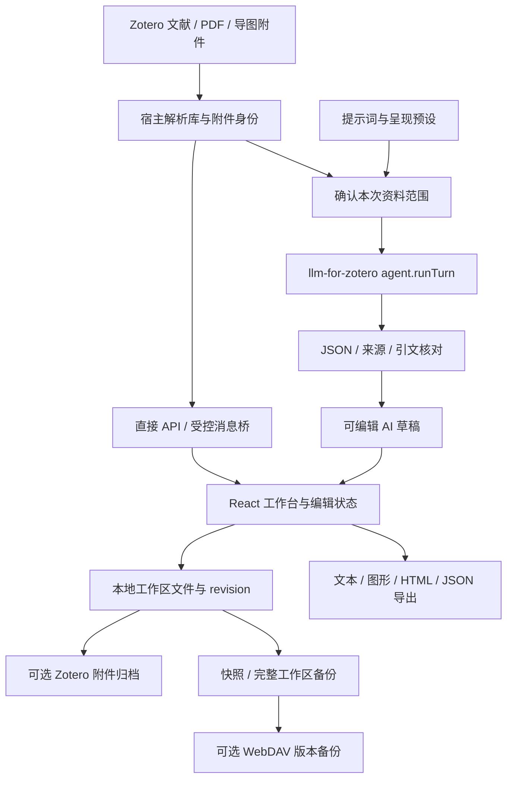

# MindFlow Zotero 插件全流程审查与优化建议

审查日期：2026-10-16。审查对象：MindFlow Zotero 插件仓库及本轮代码、测试和文档。

本报告逐步说明现有实现、数据流、错误处理、已复现的问题和后续优化顺序，并记录本次新增的“提示词与呈现预设”。除该项功能及其测试外，其余问题以审查和建议为主，**不表示已经全部修复**。

## 1. 审查结论与证据边界

当前插件已具备比较完整的“文献入口—编辑工作区—本地保存—文献附件归档—备份恢复—AI 研读”链路。多库身份识别、文档版本比较、关闭时捕获编辑、冲突副本、删除标记、AI 资料范围控制等保护已经存在，应在后续优化中保留。

最应优先处理的不是继续堆叠按钮，而是以下几类问题：

1. **导出完整性**：Markdown 遗漏根节点备注；图形导出没有接入跨节点关系线；应急备份只拿到根树。
2. **存储与输入契约**：部分关系线属性、设置及真实日期缺少有效校验；超大本地备份存在“能导出、不能导入”的不对称。
3. **AI 可核验性**：引文包含匹配不等于语义支持；全文分段候选配额会丢失进入后续阶段之前的信息；论文插图、表格和扫描件仍有明显边界。
4. **验收可信度**：历史原生总回归记录 44 项，其中 5 项失败，但 Zotero 后台把本地 11.0.0 测试包更新到 11.1.2，结果不是固定版本验收。另复核发现多项测试注入/结果汇总缺陷；“导出时保留未提交节点文字”仍未排除产品问题。
5. **工程可维护性**：宿主、主页面和设置组件较大，依赖目录还借用了另一项目；工作区与本地远端跟踪状态也不适合直接发布。

### 1.1 本轮核验结果

| 检查层级 | 本次结果 | 能说明什么 |
| --- | --- | --- |
| 修改前宿主测试 | 78/78 通过 | 当前基线的模拟宿主行为 |
| 修改前前端/逻辑 | 43＋30 项通过 | 身份、存储、导图转换、备份等既有逻辑 |
| 修改后宿主测试 | 80/80 通过 | 包含新增提示词传递、缓存区分及非法输入拒绝 |
| 修改后前端/逻辑/预设 | 43＋30＋7 项通过 | 包含预设保存、默认、删除、损坏保护及外观传递 |
| 类型检查、生产构建和 JS 语法 | 通过 | 源码可构建，生产包可解析 |
| 浏览器实际组件操作 | 通过所测流程 | 保存预设、设默认、页面重载、修改后重试 |
| 真实 Zotero 预设专用验收 | 3/3 通过 | 实际首选项持久化、实际上游 API、本地确定性服务、生成草稿 |
| 真实 Zotero 进程重启 | 1/1 通过 | 退出后重新启动仍保留更新的提示词、默认预设和呈现配置 |
| 真实 Zotero 总回归 | 历史记录 44 项，39 通过、5 失败；版本被自动更新，不能作为 11.0.0 验收；固定版本复跑未完成 | 侧栏/导入/inbox/最终汇总含测试脚本问题；节点草稿导出仍待复现 |
| 诊断探针 | 复现多项缺口 | 详见第 6 节及 JSON 原始证据 |

专用 AI 验收使用**真实 Zotero + 实际 llm-for-zotero API + 本地确定性模型测试服务**。没有把合成回答当作新的远程大模型结果，也没有评价真实论文总结质量。没有访问用户 WebDAV 账户进行上传/恢复验收，没有覆盖 macOS/Linux。没有覆盖用户主 Zotero 的插件安装。

### 1.2 本轮发布基线

- 本轮审查开始时，本地清单声明 **11.0.0**，GitHub `main` 已有 **11.1.2**；发布前已 fetch 并核对远端提交和标签。
- 审查期间工作区包含多批功能实现、回归测试和本机验证材料。公开载荷限定为插件源码、维护测试和通用文档；个人论文示例、隔离配置截图、原始测试日志及本机生成文件不属于公开载荷。
- 本文记录的是 2026-10-16 的代码审查结论。测试数字仅代表当时对应的测试运行和覆盖范围，不能替代发布版本的最终验证。

## 2. 系统分层与实现位置

| 层次 | 主要实现 | 职责 |
| --- | --- | --- |
| Zotero 生命周期 | `bootstrap.js` | 等待宿主初始化，注册 chrome 资源，加载插件运行脚本，禁用时清理 |
| 宿主入口/特权操作 | `chrome/content/scripts/index.js` | 工具栏、菜单、侧栏、标签页/窗口、文件存储、附件归档、PDF 提取、上游 AI 调用 |
| 宿主偏好界面 | `chrome/content/preferences.xhtml`、`scripts/preferences.js` | Zotero 原生插件设置 |
| React 工作台 | `source/src/pages/app/App.tsx` | 文档状态、编辑命令、保存队列、切换、导入导出及 AI 工作流协调 |
| 节点/历史/布局 | `core/model/treeOps.ts`、`core/history/historyManager.ts`、`core/layout/layoutEngine.ts` | 树操作、关系线历史、三种布局、文字尺寸与换行 |
| 交互界面 | `components/canvas`、`node`、`sidebar`、`toolbar` | 画布、节点、属性、大纲、任务、收集箱与工作区管理 |
| Zotero 通信 | `services/zotero/zoteroBridge.ts`、`documentIdentity.ts` | 直接 API/消息回退、库范围身份、附件归属 |
| AI 资料与转换 | `services/zotero/researchAnalysis.ts`、`researchTemplates.ts` | 请求状态、生成内容转换、证据备注和模板信息 |
| 内容模板定义 | `chrome/content/research-templates.json` | 各研究框架、分支键、提示要求、候选配额与组织方式 |
| 用户预设（本轮新增） | `researchPresets.ts`、`ResearchPresetsPanel.tsx` | 提示词、内容模板、主题布局组合的保存、选择和默认值 |
| 本地存储 | `services/storage/storageService.ts`、`safeStorage.ts` | 文档持久化、版本比较、设置/预设首选项 |
| 快照/完整备份 | `services/storage/backupService.ts` | 单文档快照、完整工作区导入导出、恢复预览 |
| WebDAV | `services/sync/webdavService.ts`、`webdavRequest.ts` | HTTPS、目录、版本化上传、下载、限流/超时/取消 |
| 导入导出 | `services/io/exporter.ts` | JSON、Markdown、OPML、SVG、PNG、HTML、打印 |

当前宿主脚本约 3,846 行，`App.tsx` 约 2,722 行，设置组件约 1,344 行。代码行数只是维护规模信号，不直接等于缺陷。



## 3. 核心数据与状态约束

### 3.1 五种身份不能混用

| 身份 | 实现中的信息 | 使用要求 |
| --- | --- | --- |
| 文献条目 | `libraryID + item key`、带库范围的 Zotero URI | 禁止用相同标题或裸 key 推断唯一论文 |
| 物理导图附件 | `libraryID + attachment key` | 复制附件即使内部 document ID 一样，也不能视为同一来源 |
| 工作区文档 | `MindMapDocument.id` | 标签页/窗口和本地文件的路由身份 |
| 编辑版本 | `revision`、`expectedRevision` | 保存时比较，旧窗口不可静默覆盖新窗口 |
| AI 资料预览 | `preparedId + reference + createdAt` | 请求必须对应用户确认过的文献与范围，过期则重新准备 |

`MindMapDocument` 保存根树、关系线、主题、布局、时间和 metadata。metadata 又包含文献关联、附件身份、AI 草稿状态、资料范围及模板来源等。树与关系线必须一起处理；只备份根树不等于备份整份文档。

### 3.2 保存成功应分开判断

| 阶段 | 成功的实际含义 | 不代表的结果 |
| --- | --- | --- |
| 本地保存 | 文件已写入并核对，revision 更新 | 文献下已有附件 |
| 快照 | 历史恢复点已生成 | 当前编辑已经归档 |
| Zotero 附件 | 子附件注册、路径与读回均核对 | Zotero 远端文件同步完成 |
| Zotero 大纲笔记 | 独立笔记操作成功 | 附件归档成功 |
| WebDAV | 本次备份上传结果已确认 | 实时协作、Zotero 数据库或 PDF 同步 |
| AI 引文匹配 | 指定输入中包含引文片段 | 节点判断已被语义证明、科学结论已独立验证 |

## 4. 各流程逐步实现

### 4.1 启动、注册与关闭

1. `bootstrap.startup()` 增加启动代次，等待 `Zotero.initializationPromise`；宿主尚未就绪时监听窗口。
2. 检查启动代次，避免插件已经停止后又继续初始化。
3. 注册 `chrome://mindflow` 和中英文 locale 资源。
4. 在包含 Zotero、rootURI、版本和会话恢复标记的上下文中加载 `scripts/index.js`。
5. `Zotero.MindFlow.init()` 注册原生入口、窗口监听和文献侧栏；新窗口重复执行相应安装流程。
6. 工作台 HTML 绑定 Zotero API 与初始打开动作，加载本地生产 CSS/JS。
7. React 根据初始动作打开指定文档、创建独立文档、从文献创建或进入 AI 预览。
8. 正常关闭通过编辑捕获与宿主队列保存最新文字；插件禁用清理窗口、监听器、侧栏和资源。

**边界**：正常退出保护不能直接等同于操作系统强杀/断电保护；需要专门的崩溃恢复验收。错误边界的“数据完整安全”文案也超出了它实际验证的范围。

### 4.2 工具栏、菜单与侧栏入口

1. 工具栏/快捷键调用 `triggerMindFlowOpen()`，侧栏按钮在 `registerItemPaneSection()` 中路由。
2. `resolveLiteratureTarget()` 把带父条目的 PDF/笔记转换为对应文献。
3. `getMindflowAttachments()` 查找目标文献下的 `.mindflow` 附件。
4. 一份时直接打开，多份时让用户选择；没有时进入文献关联的新建。
5. “打开工作台”进入已有工作区；“导入导图”触发文件选择。
6. “独立空白导图”传 `create_blank + forceNew`，不依赖当前选中文献。
7. PDF 快捷入口优先选中的 PDF，再选择文献的适当附件。
8. 侧栏通过 item-change/notifier 等更新标题和附件列表，destroy 时移除相应状态。

**本轮发现**：历史总回归中的侧栏快捷操作路由断言失败时，失败快照同时显示点击已打开 `ai_analyze`、`create_blank`、`create_from_selection` 标签页。回归脚本直接覆写 Zotero 暴露对象的方法；若该对象经 Xray 包装，覆写只影响包装层，不会替换实际回调调用的对象。测试脚本现已尝试优先覆写底层对象，但全量原生复跑尚未完成，因此此项不作为已确认的用户功能故障，也不作为通过项。

### 4.3 打开已有 `.mindflow` 附件与多窗口复用

1. `openMindflowAttachment()` 读取附件实际文件，并验证 JSON 与文档结构。
2. 从真实附件取得库、附件及父文献信息，而不是信任文件中遗留的绑定。
3. 依据完整来源身份寻找已存在标签页/窗口；不同附件不可仅因内部 ID 一样而复用。
4. `openMindFlow()` / `openStandaloneWindow()` 创建或定位目标容器。
5. 初始动作或 READY/ACK 消息握手把文档交给其所属 iframe；宿主验证消息拥有者。
6. `openIncomingZoteroDocument()` 和 `planIncomingDocument()` 比较本地文档来源与更新时间。
7. 同来源时保留更合适的本地状态；不同来源产生隔离工作区，避免串文献。
8. 设置活动文档、选择节点、关系线、历史与视图；会话恢复也应重新核对这些身份。

**保护已存在**：库范围、附件来源、请求代次、过时动作检查和冲突隔离。后续重构不能简化成“打开最后一个活动文档”。

### 4.4 手动创建、模板创建与导入文献

1. 新建/切换前调用 `flushCurrentDocument()` 捕获正在编辑的节点文字并保存。
2. 空白文档创建新 ID，使用默认主题/布局，不绑定当前论文。
3. 普通模板通过 `TemplateDefinition.createRoot()` 创建节点结构；该模板库与 AI 内容模板是不同入口。
4. 从选中文献创建时序列化元数据、可选摘要、笔记与批注。
5. 单篇文献保留明确的文献身份；合集需按多篇分支组织，避免把第一篇作为全部内容的归档目标。
6. 保存为本地工作区，更新活动文档，再展示画布。
7. 用户后续执行附件归档；独立/无单篇归属文档进入专门容器。

### 4.5 节点编辑、关系线、撤销与图片

| 步骤 | 主要实现 | 检查点 |
| --- | --- | --- |
| 选择/多选/定位 | `App`、Canvas、PropertySidebar | 文档切换后不能保留失效节点 ID |
| 输入编辑 | `NodeCard` 本地 editText、提交/取消事件 | 已有中文输入法组合态保护；关闭前需捕获尚未提交的文字 |
| 增删/移动/复制分支 | `treeOps` | 新节点 ID、防止移动到自身后代、删除后选择回退 |
| 关系线更新 | `validRelationships()` 与 App 命令 | 删除子树同时清理所有失效端点 |
| 历史记录 | `HistoryManager` | 同时快照根树与关系线，默认最多 50 步 |
| 标签/任务/备注/链接 | PropertySidebar、节点 patch | 链接在展示时过滤协议；任务属性仍有校验缺口 |
| 图片导入/粘贴/拖入 | `prepareNodeImage()`、imageImportBusyRef | 限格式、体积和像素；压缩后嵌入 data URL，单次处理 |
| 布局/绘制 | `computeLayout()`、Canvas、NodeCard | 主题和布局分离，共享长文本行断点 |

图片源文件限制 15 MiB，像素上限 2,400 万，压缩后的单图 data URL 上限 300,000 字符。图片数据跟随文档和快照保存，大量图片会放大历史、备份、序列化和上传成本。

### 4.6 自动保存、显式保存与冲突处理

1. 编辑改变根树/关系线，自动保存等待约 **600 ms**。
2. 保存任务进入前端 `saveQueueRef`；过期 token 或已切换文档停止继续。
3. `StorageService.saveDocument()` 进行文档结构验证并使用已知 revision。
4. Zotero 模式调用宿主 `workspaceStorage('commitDocument')`，并发写操作进入宿主队列。
5. 宿主核对预期 revision、删除标记与文档身份。
6. 写临时文件、备份、flush，读回核对；成功后递增 revision。
7. 前端仅在保存对应当前版本时更新 clean 引用；新编辑不会被旧回调标为已保存。
8. 发生冲突时保存新 ID 的副本，解除物理附件绑定并提示核对，停止原本的切换/归档。
9. 根据设置尝试自动快照；普通已关联文档可继续排队归档。
10. WebDAV 自动备份在编辑暂停约 **15 秒**后运行，结果保持与本地保存区分。

**实际文件位置**：Zotero 数据目录的 `mindflow/workspace`。设置与新增预设主要走 Zotero Prefs，并非文档正文文件。

### 4.7 附件归档与大纲笔记

1. 显式归档前刷新本地保存，AI 草稿要求用户执行审阅归档入口。
2. `saveMindMapToItem()` 冻结请求，进入与删除共享的宿主写队列。
3. 检查本地较新 revision 和同版本内容，停止过时归档。
4. 解析显式目标文献及库范围；无归属则创建/使用“MindFlow 独立导图”容器。
5. 检查父条目、文献库及附件写权限。
6. 更新指定物理导图附件或创建新附件；导图与 PDF 为同级子附件。
7. 核对父子关系、附件注册、路径、JSON 和读回内容，才返回附件成功。
8. 大纲笔记作为独立结果返回；自定义本地目录副本也不代替附件成功。
9. 前端持久化实际附件 key/libraryID 及草稿审阅状态，再允许后续自动归档。

**边界**：工作区写入、Zotero 附件注册、附件文件和笔记没有形成跨资源共同提交的事务；需要保持当前的阶段性错误提示，避免笼统“全部保存成功”。

### 4.8 收集箱、快照与完整工作区备份

1. 收集箱添加/删除/标记通过 `InboxService`；Zotero 宿主 `mutateInbox` 串行执行读—改—写，验证 ID 和结构并读回。
2. 整理入图成功后再更新处理状态，避免插入失败却已标处理。
3. 快照包含文档 ID、时间、节点数和完整文档 JSON；自动快照有时间间隔和保留上限。
4. 快照恢复先验证外层及 payload 身份，再保留当前可靠附件关联并按 revision 保存。
5. `getFullWorkspaceData()` 顺序读取文档、各文档快照与收集箱。
6. 本地导出生成带版本和导出时间的 JSON；不包含 Zotero 数据库/PDF、设置、服务凭据。
7. 恢复前验证整份输入，展示新增/替换文档等预览，并为即将覆盖的文档创建恢复快照。
8. 逐份提交文档，随后合并收集箱和快照；失败时报告已保存数量和失败阶段。

**关键边界**：完整恢复不是整批事务；备份导出也不是宿主层的一次全局一致性快照。恢复保护快照可能受保留策略影响，宜为恢复批次设置独立保留期。

### 4.9 WebDAV 备份与恢复

1. 校验 HTTPS 服务地址，拒绝内嵌凭据、查询/片段及越界路径。
2. 使用账号/应用密码构造 Basic Auth；本地没有应用层凭据加密。
3. 测试目录访问；按父目录到子目录创建 MKCOL。
4. 上传请求排队前冻结设置与备份数据，避免等候期间目标/内容被改变。
5. 上传前检查序列化大小，超过 20 MiB 拒绝。
6. PUT 唯一历史版本，再更新 latest；latest 失败保留历史版本并说明部分成功。
7. PROPFIND 列举并过滤合法版本文件；下载只允许 latest 或合法历史名称。
8. GET/PROPFIND 采用流式读取大小限制和覆盖响应体的超时；取消与超时分别处理。
9. 下载内容走工作区恢复预览和提交链路。

**可改进点**：远端历史暂未自动清理；不同客户端间没有条件更新 latest 的冲突协议；目前属于备份功能，不能当作多端实时协作。

### 4.10 文件导入、图形导出与打印

1. 导入首先刷新当前文档，限制输入文件 20 MiB，读取文本后按扩展名解析。
2. JSON/MindFlow 校验文档结构，创建新工作区 ID，重定向内部链接并解除物理附件绑定。
3. Markdown/OPML 转换为节点树；不应承诺完整元数据往返保真。
4. 导出先刷新正在编辑的文字，以捕获的当前文档重新计算布局。
5. JSON 带上关系线和 metadata；Markdown/OPML 是层级文本交换。
6. SVG/PNG/HTML 使用布局节点与树连接线生成；本轮确认未传入文档关系线。
7. PNG 使用 2 倍像素画布；PDF 使用当前 DOM 打印并依赖宿主对话框。

| 格式 | 当前实际保留范围 | 重点缺口 |
| --- | --- | --- |
| 正常 JSON | 整份文档、关系线、metadata、图片 | 体积可能超过当前导入上限 |
| Markdown | 标题、子节点、部分备注/链接/任务 | 根备注丢失；多行备注和 Zotero 链接往返不完整 |
| OPML | 大纲及部分属性 | 不等于完整工作区备份 |
| SVG/PNG/HTML | 当前布局树形内容 | 跨节点关系及部分任务、图标等视觉元素未统一导出 |
| 打印/PDF | 当前实时 DOM | 页面分页、大画布及系统打印行为需额外验收 |
| 应急 JSON | 根节点树 | 非完整文档，不能据此宣称全部状态安全 |

## 5. AI 研读与预设：逐步追踪

### 5.1 资料准备和用户确认

1. `handleAnalyzeZoteroPaper()` 从显式文献引用或当前文档关联解析目标。
2. 默认读取 **仅摘要**。准备阶段只读本机资料，不调用模型。
3. `preparePaperAnalysis()` 取得上游可用模型及推理选项，只把公开配置送给前端。
4. 优先条目摘要；为空时尝试在 PDF 前几页识别摘要。用户手工补充文字会标注来源未与 PDF 对齐。
5. PDF 优先最佳附件，再遍历附件；找到可用文字后采用该附件，目前没有用户选 PDF/补充材料的完整入口。
6. PDF 文字提取按 50/120/200 页设置执行；摘要定位最多前 5 页。扫描件无可提取文字时提示失败。
7. 缓存按库、附件、路径、页数、文件大小和修改时间区分，约五分钟失效，最多保留三个提取结果。
8. 部分章节识别失败时报告缺失，不自动扩大到全文。正文、摘要及笔记批注另有字符/条数上限。
9. 笔记最多 12 条、每条 2,500 字符；批注最多 80 条，划线 600 字符、评论 300 字符。预览提示截取/遗漏。
10. 用户选择资料勾选、模型、推理强度、内容模板和本次提示词/呈现方式。笔记与评论默认不发送。

### 5.2 从请求到可编辑草稿

1. 开始分析时冻结用户选定外观；未选呈现预设则继承当前导图或设置默认值。
2. 宿主验证 preparedId、对应论文、15 分钟有效期、模型指纹与页数偏好。
3. 宿主再次验证模型和推理选项；补充提示词必须是文本且不超过 6,000 字符。
4. 过滤未选择的来源；构造 `AB/P/N/A/C` 来源编号，实际发送范围独立于资料预览的本地准备范围。
5. 缓存键区分模板及版本、模型指纹、推理、分析模式、资料勾选和**补充提示词**。
6. 部分读取采用一次综合分析；全文快速模式跨区间采样，全文深入模式按约 24,000 字符分段，再整合候选。
7. 系统提示词约束严格 JSON、研究栏目、事实/推断/未解决分类、逐字引文与数值条件；用户补充偏好只调整重点与表达。
8. 只调用 `Zotero.LLMForZotero.api.agent.runTurn`，不新增 MindFlow 自有模型密钥或 HTTP 请求配置。
9. 请求采用独立上下文，阻止额外工具读取其他资料；支持超时、取消、进度与中途失败后恢复已完成分段。
10. 接受上游 completed 结果，解析 JSON，验证栏目、主题编号和候选引用。不是所有科学内容都能由这些结构检查验证。
11. 引文在指定来源中进行规范化包含匹配；缺失、未知来源、模糊匹配等保留不同核验状态。
12. 读者笔记/评论只能支持推断，手工补充摘要不提升为已确认论文事实。
13. `createResearchDocument()` 转换节点，将条件、引文、来源和核验信息保存为备注。
14. 论文精读模板合并成至多五条主线和三个核心发现；主图之外的已接收条目放入根节点补充备注。
15. 使用用户本地选择的主题/布局，不能让模型输出改写外观配置。
16. 先保存本地草稿，记录模型调用来源、run IDs、内容模板、提示词及呈现配置；清空旧文档编辑历史。
17. 草稿默认不自动归档；审阅后通过专门入口归档，归档成功再保存关联状态。

**不能过度解释的地方**：根备注保留的是已经进入转换阶段的候选；前面因字符/条数/模型提取配额而没进入后续阶段的内容，不会自动出现在根备注中。全文模式也不保证全文所有信息都被覆盖。

### 5.3 本轮已实现的提示词与呈现预设

入口：AI 分析窗口的 **“提示词与呈现预设”** 区域。

| 能力 | 本轮状态 |
| --- | --- |
| 提示词范例 | 通用精读、证据与机理、实验复现、组会汇报 |
| 自定义补充提示词 | 可编辑，最多 6,000 字符，宿主和预设服务双侧限制 |
| 呈现模板 | 沿用当前导图、论文精读青绿双侧、学术报告向右逻辑、研究大纲向下层级 |
| 自选外观 | 现有主题与三种布局可组合保存 |
| 命名预设 | 最多 30 个，名称 1–60 字符；包含内容模板、提示词、主题与布局 |
| 管理 | 另存为新、更新所选、设默认、取消默认、删除 |
| 跨次复用 | 默认预设在打开窗口时载入；真实 Zotero 首选项持久化已验收 |
| 重试 | 本次修改不会因进入运行/错误状态而重新载入默认配置 |
| 缓存与溯源 | 提示词进入缓存键，实际提示词和最终呈现写入生成文档 metadata |
| 损坏保护 | 结构、ID、主题、布局和默认引用校验；坏数据明确报错，不静默覆盖 |

预设记录单独保存在 `mindflow.mindflow_research_presets_v1` 首选项。读—改—写同步完成并每次重读，避免陈旧列表覆盖其他新增预设；同一条预设的并发编辑还没有 revision 冲突提示。

**用户操作**：选择内容模板 → 填补充提示词 → 选呈现模板或主题/布局 → 填名称 → 另存为新预设 → 设为默认。以后直接选择该预设，确认文献和读取范围后分析即可。“设为默认”引用已保存的版本，尚未保存的编辑需先点“更新所选预设”。

当前呈现模板是主题和布局组合，并非任意 HTML/CSS 或自定义节点 renderer；内容模板仍选择内置 schema，不支持用户任意改分支键。模型、推理和阅读范围仍需按本篇文献确认，不因套用预设而扩大资料范围。


## 6. 问题清单、证据和优化方式

优先级：P1＝建议下一轮优先处理，涉及数据保真、可恢复性、错误运行或发布验收；P2＝明确能力边界或维护/体验优化。没有证据把本轮结果描述为“所有路径均安全”，也未确认新的 P0 级普遍数据覆盖故障。

### 6.1 P1：优先处理

| ID | 问题与触发方式 | 当前证据/实现 | 建议修复与验收 |
| --- | --- | --- | --- |
| P1-01 | Markdown 丢失根节点备注，AI 补充证据随之丢失 | `exportToMarkdown()` 只写 `root.text`，walk 仅处理 children；探针 root marker 未进入导出 | 根备注作为正文/附录导出；测试根备注、多行引文、补充条目数量完整保留 |
| P1-02 | 图形导出不包含跨节点关系线及标签 | App 只给导出器 nodes/connections；探针 1 条关系、2 条树连接，SVG 仍只有 2 条路径且无关系标签 | 统一画布与导出渲染数据模型，显式传 relationships；验收 SVG/PNG/HTML 三种格式 |
| P1-03 | 关系线可接受对象类型 label 等无效属性 | `validateMindMapDocument()` 与宿主只核对 ID 和端点；探针对象 label 被接受 | 双端校验 label:string、style 枚举、color:string，并保留画布错误恢复；导入异常属性必须拒绝 |
| P1-04 | 设置没有完整 schema 校验 | `SettingsService` 直接 parse＋deepMerge；探针接受 invalid-layout 和负快照数量 | 所有设置验证类型、范围和枚举；损坏设置隔离并提示，迁移按版本执行 |
| P1-05 | 本地完整备份“能导出但不能导入” | 探针实际导出 20,972,473 字节，随后导入被 20 MiB 上限拒绝 | 导出前同一上限预检并明确阻止，或采用分卷/压缩/流式恢复；不能提供不可恢复的“完整备份”却无说明 |
| P1-06 | 应急备份只导出根树，却显示“底层数据完整安全” | `CanvasErrorBoundary` 只接收 rootNode，`exportToJSON(rootNode)` 新建简化文档 | 传整份最后可用文档与当前关系线、metadata；区分内存恢复与已落盘状态，删除无依据保证 |
| P1-07 | 原生总回归验收不完整且测试版本漂移 | 存档 44 项：39 通过、5 失败。启动日志先记录插件 11.0.0 `APP_STARTUP`，后记录 11.1.2 `ADDON_INSTALL`；包的 `applications.zotero.update_url` 指向在线更新清单。侧栏路由与存储失败注入通过包装对象覆写，冷启动导入探针漏掉 `frameElement` 初始动作，最终汇总把无 `docId` AI 临时标签页当成文档。节点草稿导出断言仍未解释 | 一次禁用隔离包更新地址的尝试导致新 profile 未列出 MindFlow 扩展，因此固定版本总回归仍未完成。探针和结果汇总脚本已修正。先确认固定包可被原生加载，再跑完整回归并单独复现 JSON 导出；不能将漂移版本结果或 AI 预设专用验收当作总回归通过 |
| P1-08 | 完整恢复不是整批事务，失败会留下部分替换 | `importFullWorkspaceData()` 文档逐份提交，再处理 inbox/snapshots | 增加恢复批次 manifest、提交日志与撤销恢复；注入第 N 份失败、磁盘满和窗口冲突测试 |
| P1-09 | 引文匹配容易被理解成结论得到证明 | 实现只做来源内文字包含；界面仍出现“原文支持”表述 | 统一称“引文匹配”；另列语义支持/作者解释/人工确认，加入引文与判断相矛盾、单位和比较基准丢失样例 |
| P1-10 | 发布基线不清，不能直接覆盖发布 | 审查开始时本地版本为 11.0.0，GitHub main 为 11.1.2，工作区含多批改动 | 已核对远端提交与标签；发版时同步版本表面和更新源，构建并核验发布包；原生总回归边界保留在发布记录中 |

上述 P1-01～05 的诊断来自本机合成数据探针，原始输出未纳入公开附件。P1-06、08、09、10 属于直接源码/仓库证据；它们不表示本轮人为破坏了用户真实数据。

### 6.2 P2：明确缺口与后续优化

| ID | 问题/边界 | 证据 | 具体优化 |
| --- | --- | --- | --- |
| P2-01 | 备份 version 没有兼容性门禁 | `validateWorkspaceData()` 不校验版本/导出时间；999.0.0 的合成备份预览被接受 | 使用独立 schemaVersion，已知旧版本迁移、未知新版本拒绝，应用版本只作溯源 |
| P2-02 | 备份导出没有统一一致性时点 | `getFullWorkspaceData()` 顺序 await 读取多文档 | 宿主提供冻结 revision 清单的 snapshotWorkspace；导出后复核版本集合 |
| P2-03 | 任务截止日期只检查外形 | 2026-99-99 可通过前端/宿主同类正则 | 校验实际日历、闰年和月份天数；统一时区无关日期语义 |
| P2-04 | 多 PDF、正文与 SI 的选择不完整 | 自动选择优先附件，预览只显示实际读取附件 | 提供附件选择及角色标记，分别记录正文/SI/勘误，逐项确认发送范围 |
| P2-05 | PDF 仅文字提取，图表和扫描内容不足 | PDFWorker.getFullText，未见 OCR/视觉图表理解链路 | 先支持页码/段落定位和图表索引；OCR/视觉分析作为单独 opt-in 能力，保留截图来源 |
| P2-06 | 分段候选配额是信息瓶颈 | 每段每栏 story 最多 8 条、整合最多 24 条；最终模板还有显示上限 | 持久化完整候选证据库，显示层再筛选；报告“读取/提取/匹配/显示/省略”的分阶段覆盖数 |
| P2-07 | 自定义提示词没有质量评测面板 | 本轮新增的是可复用配置与可追溯请求 | 建立少量真实文章标准集，对比不同预设的事实保留、错误、可读性与调用成本 |
| P2-08 | 预设不随当前工作区备份迁移 | WorkspaceBackupData 仅 documents/inbox/snapshots | 增加独立预设 JSON 导入导出或备份新字段，不把凭据纳入；需兼容旧备份 |
| P2-09 | 同一预设并发更新无冲突提示 | 同步重读保护目录新增，未给单记录 revision | 对单条记录加 revision/updatedAt/CAS；同名副本和内置恢复入口也可补充 |
| P2-10 | 大图绘制及关系线查找成本偏高 | Canvas 两处对每条关系 nodes.find，历史每步克隆根树 | 建 nodeId→LayoutNode 索引，视口裁剪、稳定 memo；大文档考虑增量布局和 patch history |
| P2-11 | PNG 没有总像素/内存预算 | canvas.width/height 直接按 bounds×2 分配；highDpi 参数未用于选择倍率 | 预估宽高及 RGBA 内存，超限建议 SVG、降 DPI 或分块，测试 getContext 失败与编码失败 |
| P2-12 | 画布/导出样式存在多个实现 | NodeCard、SVG、Canvas 2D、HTML 各自绘制；部分分支不渲染任务/图标等 | 共享 render model，加入复杂节点与多行文本的视觉对照验收 |
| P2-13 | WebDAV 历史无限积累且跨端 latest 无冲突协议 | 上传创建唯一版本，未见清理或条件更新 latest | 添加用户可配置保留规则和容量提示；跨端使用 ETag/If-Match 或独立客户端索引 |
| P2-14 | 设置双份存储可能部分同步 | 写完整设置后再 mirror 到 extensions.mindflow.* | 指定唯一权威数据，原生设置走同一服务；镜像失败显示具体同步状态 |
| P2-15 | 多个弹窗缺少统一可访问交互 | AI 弹窗有焦点约束；普通模板/设置/快捷键弹窗未采用同套机制 | 共用 Dialog 组件：语义、Esc、焦点环、关闭后恢复焦点、可访问名称 |
| P2-16 | 构建环境依赖另一 checkout 且仅 Windows 脚本 | source/node_modules 是 Mindmapext 目录 Junction；build-local 调 cmd.exe；npm ls 有 extraneous 记录 | 独立干净安装环境执行 npm ci，检查锁文件；使用跨平台子进程入口；不能凭当前成功构建推断干净机器可复现 |
| P2-17 | 大模块和双份校验维护易漂移 | 宿主约 3,846 行，App 约 2,722 行，TS/宿主各有文档 validator | 按文件存储、入口/会话、归档、AI、侧栏拆模块；共享 schema 或自动生成同源校验 |
| P2-18 | Markdown 往返进一步损失内容 | 导出多行 note 写 HTML 注释，导入逐行解析且备注正则非跨行；链接解析限 HTTP(S) | 定义可往返的 Markdown 方言或明确标为单向；补多行引文和 zotero:// 链接测试 |

这些条目区分了**当前已复现缺陷**、**源码可见的能力边界**和**建议建设的能力**。性能项尚未做大规模基准，不能给出“超过某个节点数必卡顿”的未经测量结论。

## 7. 推荐实施顺序与验收标准

### 第一批：内容和备份保真

1. 修 Markdown 根备注、多行引文及 Zotero 链接；对 AI supplementaryCount 做导出前后数量核对。
2. 补图形关系线，先抽统一关系路径/标签数据，再接 SVG、PNG、HTML。
3. 统一节点/关系/设置 schema，日期验证使用真实日历。
4. 对齐备份导出/导入限制；应急备份改整份文档。
5. 定位总回归失败，增加全局时限、失败时 DOM/待处理动作记录，避免持续停滞。

验收：含长备注、图片、任务、内部链接、关系线和 AI 来源信息的固定导图，通过 JSON 完整往返；Markdown 证据不丢；图形关系线不丢；超限备份给出可恢复的路径。随后完成真实 Zotero 关闭/重启/多窗口回归。

### 第二批：AI 阅读的可核验与模板体验

1. 把“引文匹配”“语义支持”“人工已核验”分开，节点与根摘要一致。
2. 保存全部已提取候选，而非只保存最终展示候选；增加证据列表和来源跳转。
3. 提供正文/SI 附件选择和准备阶段本地预览。
4. 为新预设补导入导出、更新冲突和修改未保存标识。
5. 用真实文章比较预设，记录模型、范围、模板版本、提示词、候选保留数与费用信息。

验收：更换主题不改变证据内容；更换提示词使缓存失效；切换范围不扩大资料；取消不生成/归档导图；模型引用错误片段或提出不支持结论时，不能自动标成已核验。

### 第三批：维护、性能与发布

1. 建立独立依赖安装与 CI，拆分宿主和 App 的协调逻辑。
2. 加恢复批次日志和完整撤销恢复设计。
3. 测试 100/500/2,000/10,000 节点、图片占比和不同关系密度，记录首屏、编辑延迟、保存/导出耗时及内存。
4. 依据测量再做视口裁剪、索引、增量布局和历史结构优化。
5. 在真实 WebDAV 测试账户验证断网、401、目录失败、latest 失败、跨端覆盖、20 MiB 边界和恢复中断。
6. 清楚区分发布版本和本地派生包，核对原生侧栏、标签页、独立窗口及重启恢复后再发版。

## 8. 本次改动与验证文件

### 8.1 新增/接入的生产代码

- `source/src/services/zotero/researchPresets.ts`：预设数据类型、默认值、范例、校验及持久化。
- `source/src/components/modal/ResearchPresetsPanel.tsx`：预设管理与主题布局组合界面。
- `AIResearchModal.tsx`：接入预设，保留运行/错误期间输入；焦点循环忽略隐藏控件。
- `researchAnalysis.ts`：提示词通信参数及来源字段。
- `App.tsx`：用户选择的呈现方式进入最终文档；记录 `aiPresentation`。
- `chrome/content/scripts/index.js`：宿主校验提示词、发送补充偏好、区分缓存并记录实际提示词。

没有在本轮把第 6 节问题清单全部修复；没有覆盖用户主 Zotero 配置。默认外观仍继承当前导图，只有显式选择呈现预设才改变新生成导图的外观。

### 8.2 运行命令

```powershell
# 工作区根目录
node --test scripts/test-host.mjs
node scripts/build-local.mjs
python scripts/package-xpi.py --output mindflow-zotero-11.2.0.xpi

# source 目录
npm test
npm run typecheck
./node_modules/.bin/vite-node.cmd tests/audit-current.ts

# 专用原生测试：实际上游插件 API + 本地测试服务
pwsh -NoProfile -File scripts/start-native-test.ps1
```

`audit-current.ts` 用合成数据和内存存储诊断已知缺口，与正常通过测试分开；不对用户文献执行破坏性实验。

### 8.3 可审阅证据

实现和可重复测试位于本仓库的 `source/src/services/zotero/researchPresets.ts`、`ResearchPresetsPanel.tsx`、`source/tests/test-research-presets.ts`、`scripts/test-host.mjs` 与 `scripts/native-regression.js`。发布构建与 XPI 清单由 `scripts/build-local.mjs`、`scripts/package-xpi.py` 生成。本机运行日志和隔离 Zotero 资料未作为公开附件。
- [原生总回归中断前记录](audit-20261016-native-partial.json)
- [原生回归失败项复核说明](audit-20261016-native-followup.json)
- [缺陷诊断探针](audit-20261016-probes.json)
- [依赖目录检查](audit-20261016-dependencies.json) / [仓库状态检查](audit-20261016-repository.json)
- [预设界面截图](audit-20261016-presets-ui.png)

本轮通过的测试证明所测路径满足断言；不证明未测流程、远端服务兼容性或 AI 科学结论正确。历史原生总回归发生插件版本漂移，当前固定版本总回归仍未完成。后续验收应优先在关闭自动更新的隔离环境重跑、单独定位节点草稿导出，再补真实远端模型质量和备份恢复闭环。
